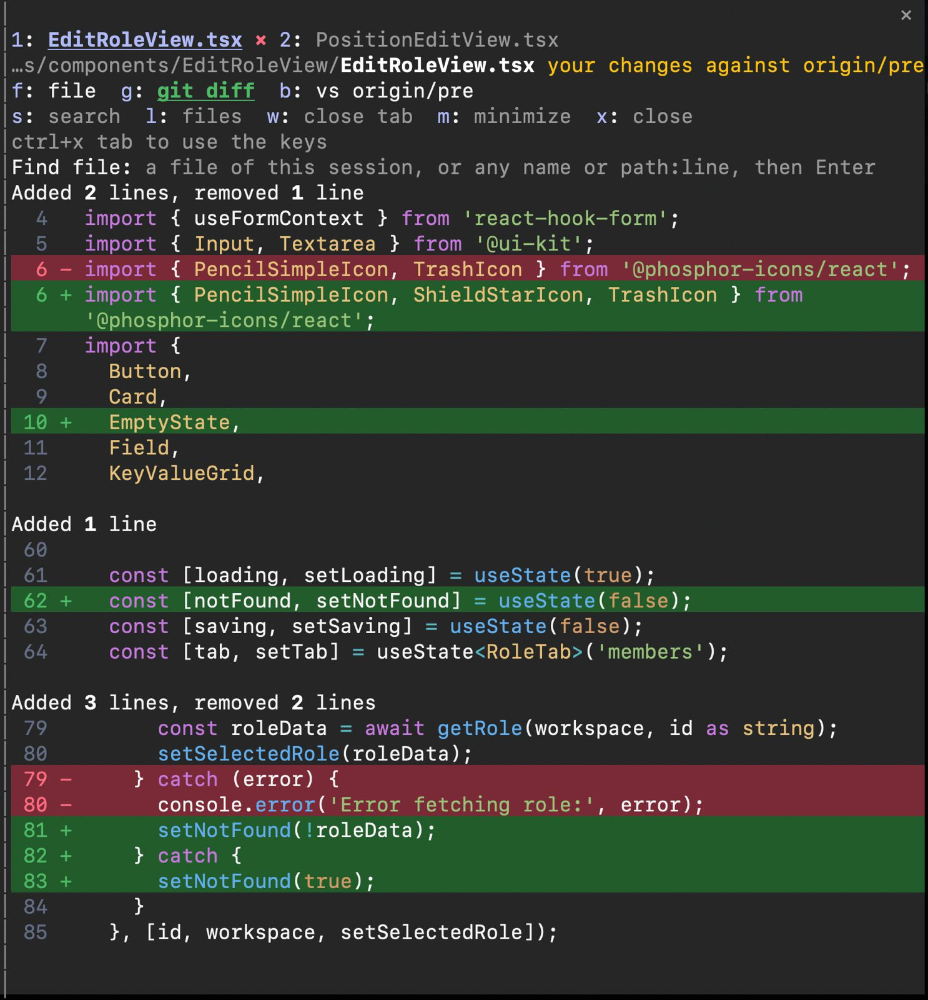

<div align="center">

# 👁 Code Viewer for Claude Code



**Read the code Claude is touching without leaving the conversation.**

A side pane for [Claude Code](https://claude.com/claude-code) with tabs, fuzzy file search, syntax highlighting and clean diffs.

[](.claude-plugin/plugin.json)
[](https://claude.com/claude-code)
[](https://www.anthropic.com/claude)
[](LICENSE)

</div>

---

> **v0.0.5** lets you mark files as read in the HTML page, and `/code-viewer html clean` deletes the pages the plugin wrote.
>
> **v0.0.4** wrote your diffs as an HTML page for the browser: every file changed against a branch, or every file Claude changed this session, with a file tree, syntax highlighting, search and keys to step through changes. Claude made one for you when you asked.
>
> **v0.0.2** added a list of every file changed against a branch, diffs of deleted, new and renamed files, paging of long diffs, stricter base branch matching and many keyboard and highlighting fixes. The Claude Code mod API is early access and can change between releases; this version was written against Claude Code 2.1.322.

## ✨ What it does

| | Feature | How it works |
| --- | --- | --- |
| 👁 | **One button to open it** | A `👁 code viewer` row sits above the prompt. Click it to open the pane; it steps aside while the pane is open, so `ctrl+x tab` goes straight to the pane. `/code-viewer` opens and closes it too. |
| 🗂 | **Session files** | The pane lists the code files Claude changed (`±`), read (`▸`) or named in an answer (`·`), latest first. Files changed from a shell command (`sed -i`, a script) count too, inside a git repository. |
| 🔎 | **Fuzzy search** | Type part of a name or path and results appear under the field as you type. `Enter` opens the first; `↓` picks another. |
| 🔦 | **Search in a file** | Press `e` on a file and type: every match is highlighted, and `Enter`, `↓` and `↑` jump between them across the whole file. |
| 📑 | **Tabs** | Every file you open stays as a tab (up to nine). Hover a tab to get a red `×`, or press `w`. |
| 🎨 | **Syntax highlighting** | JavaScript, TypeScript, JSX/TSX, Python, JSON, YAML and Markdown use a themeable highlighter. Other languages use Claude Code's own. |
| 🧩 | **Claude's diff** | See exactly what Claude changed in a file, block by block, with `Added N lines, removed M lines` headers. |
| 🌿 | **Git diff against a branch** | Pick a base such as `origin/dev` and see only your own changes: the file is compared with the commit your branch forked from. |
| 🌐 | **HTML diff in the browser** | Ask Claude ("show me the changes against dev in the browser"), press `h` in the pane, or run `/code-viewer html`. One page with every changed file: a tree with counts, colors, unchanged lines that open with a click, search in every diff and in a file. |
| 🧭 | **Works across repositories** | If Claude works in another repository or a sandbox folder, its files are indexed and searchable too. Scratch files in temporary folders (`/tmp`, `/var/folders`) are left out. |

## 📦 Install

Try it from a local clone:

```bash
git clone https://github.com/LlomenYT/code-viewer-claude-mod.git
claude --plugin-dir ./code-viewer-claude-mod
```

Or install it from its marketplace, at the prompt of a Claude Code session:

```
/plugin install code-viewer --marketplace LlomenYT/code-viewer-claude-mod
```

Answer `y` to add the marketplace, then pick a scope.

## 🚀 Usage

1. Click `👁 code viewer` above the prompt, or run `/code-viewer`.
2. Pick a file from the session list, or type part of its name in `Find file`.
3. Switch between the file, Claude's diff and the git diff from the pane.

You can also open things straight from the conversation:

- Every `Read`, `Edit` and `Write` row gets a `▸ view code` button, and `± view diff` when the call changed the file.
- `/code-viewer src/app.ts:42` opens a file at a line.
- `/code-viewer diff src/app.ts` opens its git diff.

### 🌐 The HTML diff

A page that opens in your browser, made from the plugin's own template (`assets/diff-viewer.html`):

- **Against a branch:** every file your branch changed since it forked from the base, uncommitted and untracked files included.
- **This session:** every file Claude changed, against how it was before Claude first changed it. The plugin keeps a copy of each file before Claude's first `Edit` or `Write` (in `/tmp/code-viewer-snapshots/`). Files changed by a shell command are compared with the last commit.

Three ways to make one:

| How | What it writes |
| --- | --- |
| Ask Claude: *"show the changes against origin/dev as HTML"*, *"open what you changed this session in the browser"* | Claude calls the plugin's `html_diff` tool, which takes `source` (`git` or `session`), `base`, `title`, `paths` (only some files), `folder`, `output`, `open`, `context` and `language` (`en`, `es`). |
| `h` (**view on browser**) in the pane | The changes against the base you picked when the pane shows the git diff or the changes list; otherwise Claude's changes this session. |
| `/code-viewer html`, `/code-viewer html origin/dev`, `/code-viewer html session` | The changes against the picked base, against the named one, or the session's. `/code-viewer html clean` deletes the pages written so far. |

Keys in the page: `Ctrl+P` files, `Ctrl+Shift+F` search in every diff, `Ctrl+F` find in the file, `Alt+↑`/`Alt+↓` previous or next file, `N`/`Shift+N` next or previous change, `R` mark as read, `W` wrap lines. The URL keeps the file open (`page.html#src%2Fapp.ts`).

**Mark as read:** `✓ Mark as read` (or `R`) closes the file, puts a green tick next to it in the tree and moves on to the next unread file. The header counts how many you have read. A read file opens closed, with a button to show its changes anyway. The marks belong to that page alone and stay in your browser: a page generated again starts with nothing read.

**Cleaning up:** the plugin remembers every page it writes. From 50 pages on, each new one says so and suggests `/code-viewer html clean`, which deletes those pages (only the plugin's, wherever they were written) and the file snapshots of earlier sessions.

For a page of your own, copy `assets/diff-viewer.html`, change it, and set the `htmlTemplate` option to the copy. The plugin puts the diff as JSON in place of `__CODE_VIEWER_DATA__` and the theme's colors in place of `/*__CODE_VIEWER_THEME__*/`.

### Where the pane goes

| Layout | Placement | Input |
| --- | --- | --- |
| `/tui fullscreen`, terminal at least 110 columns wide | Docked to the right of the conversation | Mouse and keyboard |
| Default layout | Above the prompt | Keyboard |

### Keys inside the pane

| Key | Action |
| --- | --- |
| `s` | Put the cursor in `Find file` |
| `↑` `↓` | Scroll, or walk the search results |
| `1`–`9` | Switch tab |
| `w` | Close the current tab |
| `l` | Back to the session files |
| `f` / `c` / `g` | File / Claude's diff / git diff |
| `b` | Choose the branch to diff against |
| `d` | List every file changed against that branch (`/code-viewer changes` does the same) |
| `h` | View on browser: write the diff as an HTML page and open it |
| `e` | Search in the file in view: `Enter` or `↓` next match, `↑` previous, `Enter` on an emptied field closes it |
| `p` / `n` | Previous / next page, of a file or of a long git diff |
| `k` | Clear the session files list (while it is shown) |
| `m` | Minimize to one line |
| `x` | Close the pane |
| `Esc` | Back to the prompt |

When the pane does not have the keyboard, `ctrl+x tab` gives it to the pane.

### Limits

- Files are shown 200 lines at a time; a diff shows its first 400 lines.
- Files over 4 MiB and binary files are not shown.
- The session list only keeps code files: no `.txt`, `.md`, `.json`, and nothing under `.claude/`.
- The git diff uses your local copy of the base branch; it does not run `git fetch`.
- The pane docks to the right only in `/tui fullscreen` and from 110 columns: Claude Code decides where panes go, and a mod cannot change it.
- An HTML page holds up to 500 files. A file over 20,000 lines shows its changes, but its unchanged lines cannot be opened. Colors come from the plugin's highlighter (JavaScript, TypeScript, Python, JSON, YAML, Markdown); other languages are plain.
- The session page only knows the files Claude changed after this version was installed and loaded.

## ⚙️ Options

Set them in `/config`, under the plugin's name. A color is a hex value (`#c678dd`) or a color name; leave it empty to keep the theme's.

| Option | Default | What it does |
| --- | --- | --- |
| `theme` | `one-dark` | The color theme. |
| `highlighter` | `theme` | `engine` leaves every file to Claude Code's highlighter. |
| `wrapLines` | `true` | Wrap long lines instead of cutting them. |
| `keywordColor`, `stringColor`, `commentColor`, `numberColor`, `functionColor`, `typeColor`, `propertyColor` | theme | One token color each. |
| `lineNumberColor` | theme | The gutter. |
| `backgroundColor` | terminal's | Painted under the pane. |
| `diffAddedColor`, `diffRemovedColor` | your Claude Code theme's | Backgrounds of added and removed lines. |
| `htmlLanguage` | `en` | The labels of the HTML page (`en`, `es`). Claude picks the conversation's language when it makes one. |
| `htmlOutputDir` | `/tmp/code-viewer` | Where HTML pages are written. |
| `htmlOpen` | `true` | Open each page in the browser (`open` on macOS, `xdg-open` on Linux). |
| `htmlContext` | `3` | Unchanged lines around each change; the rest open with a click. |
| `htmlTemplate` | the plugin's | Your own copy of `assets/diff-viewer.html`. |

## 🛠 Development

| File | What is in it |
| --- | --- |
| `hooks/register.tsx` | The hooks and everything drawn: tool-row buttons, the row above the prompt, the pane. |
| `hooks/actions.ts` | What each press does: open files, run git, search, track the session's files. |
| `hooks/html.ts` | The HTML diff: the session's snapshots, collecting the files, coloring each line, writing the page. |
| `assets/diff-viewer.html` | The page's template: layout, styles and the script for the tree, search and keys. |
| `hooks/files.ts` | Paths, patches, mentions and file ranking. Pure text helpers. |
| `hooks/tokenize.ts` | The line tokenizers, one function per language. |
| `hooks/themes.ts` | The themes and the options that override them. |
| `types/index.d.ts` | The shape of the mod's stored state. |
| `tests/code-viewer.test.tsx` | The test suite. |

Check a change with:

```bash
claude plugin validate .
claude plugin test .
```

- **A new theme:** add an entry to `THEMES` in `hooks/themes.ts` and its name to the `theme` options in `.claude-plugin/plugin.json`.
- **A new language:** add its extensions to `EXTENSIONS` and a `(line, state) => { spans, state }` function in `hooks/tokenize.ts`.

## 📄 License

[MIT](LICENSE)

---

<div align="center">

Made for <a href="https://claude.com/claude-code">Claude Code</a> · Code Viewer v0.0.5

</div>
